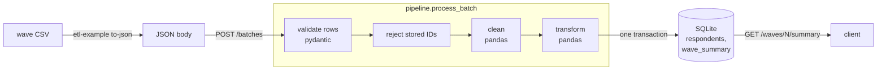
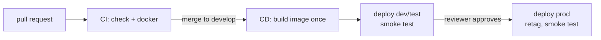

# etl-example

[](https://github.com/cieslarjacek/etl-example/actions/workflows/ci.yml)
[](https://github.com/cieslarjacek/etl-example/actions/workflows/cd.yml)

An API that simulates collecting and processing data from a brand
tracking survey. Each wave of interviews arrives as a CSV export, is
sent to the API as JSON, and is then validated, cleaned, transformed and
loaded into a SQL database. After every load, the brand awareness and
usage totals are recalculated per age category for each wave that
received new rows.

**Stack:** Python 3.15, FastAPI, pydantic, pandas, SQLAlchemy Core,
SQLite, uv, pytest, mypy `--strict`, ruff, Docker, GitHub Actions.

## The scenario

Waves 1 and 2 are already stored. Wave 3 arrives with 12 rows
([`data/wave3.csv`](data/wave3.csv)):

| Row | Respondent | What happens |
|---|---|---|
| 1, 2, 4, 8, 11, 12 | 3001, 3002, 3004, 3007, 3009, 3010 | loaded into wave 3 |
| 3 | 3003 | loaded; `brand3_usage` corrected to 0 (not aware of brand 3) |
| 5 | 2012 | **late wave 2 interview**: loaded into wave 2 |
| 6 | 3005 | loaded; the unanswered `brand2_usage` stays missing |
| 7 | 3006 | dropped: no awareness or usage answer at all |
| 9 | 3008 | dropped: invalid date `31/09/2026` |
| 10 | 1005 | dropped: ID already stored in wave 1 |

Result: 9 of 12 rows loaded, and the summaries of **waves 2 and 3** are
rebuilt. Wave 2 now has 12 respondents instead of 11.

## Architecture



| Module | Responsibility |
|---|---|
| `survey.py` | Survey layout: brands, age categories, column names, date formats |
| `validation.py` | Per-row validation at the API boundary (pydantic) |
| `transform.py` | Cleaning and derived columns (pandas, pure functions) |
| `database.py` | Tables, transactional load, summary refresh (SQLAlchemy Core) |
| `pipeline.py` | `process_batch`: chains the steps and builds the report |
| `api.py` | FastAPI app factory and routes |
| `settings.py` | dev/prod settings selected by `APP_ENV` |
| `survey_csv.py`, `cli.py` | CSV to JSON conversion, `etl-example to-json` |
| `asgi.py` | Entry point for uvicorn |

## Quick start

### 1. Notebook, no server and no Docker

```bash
make install          # uv sync: Python 3.15 and the locked dependencies
```

Open [`notebooks/example.ipynb`](notebooks/example.ipynb) in Jupyter or
VS Code with the `.venv` kernel. Alternatively, run it headless with
`make notebook`. The notebook calls the API in-process through FastAPI's
`TestClient`, using a temporary database.

### 2. Docker and curl

```bash
make docker-build                 # multi-stage build, image etl-example:local
make docker-run-dev               # container "etl-example" on port 8000
make demo                         # scripts/demo.sh: waves 1-3 via curl
make docker-stop
```

Each step of the demo runs a plain command that you can also type
yourself:

```bash
# CSV -> JSON inside the container, piped into curl on the host
docker exec etl-example etl-example to-json data/wave3.csv \
  | curl -s -H "Content-Type: application/json" --data-binary @- \
      http://localhost:8000/batches

curl -s http://localhost:8000/waves/2/summary
curl -s http://localhost:8000/health
```

In dev, Swagger UI is served at <http://localhost:8000/docs>. A container
started with `make docker-run-prod` hides `/docs`.

### 3. Local server

```bash
make run-dev                      # uvicorn with --reload, APP_ENV=dev
```

## API

| Method and path | Purpose | Responses |
|---|---|---|
| `GET /health` | Liveness and environment | 200 `{"status": "ok", "environment": "dev"}` |
| `POST /batches` | Upload `{"respondents": [ {row}, ... ]}` | 200 batch report; 422 malformed body; 409 concurrent duplicate |
| `GET /waves/{wave}/summary` | Totals per age category | 200 summary; 404 wave not stored |

Batch report (wave 3, shortened):

```json
{
  "rows_received": 12,
  "rows_loaded": 9,
  "dropped_rows": [
    {"row_number": 7, "respondent_id": 3006, "reason": "no_answers",
     "detail": "all awareness and usage answers are missing"}
  ],
  "corrected_rows": [
    {"row_number": 3, "respondent_id": 3003,
     "reason": "usage_without_awareness",
     "detail": "brand3_usage set to 0 because brand3_awareness is not 1"}
  ],
  "refreshed_waves": [2, 3]
}
```

Wave summary (one age category shown):

```json
{
  "wave": 2,
  "age_categories": [
    {"age_category": "35-44", "respondents_total": 3,
     "brands": [
       {"brand": "brand1", "awareness_total": 3, "usage_total": 3},
       {"brand": "brand2", "awareness_total": 2, "usage_total": 0},
       {"brand": "brand3", "awareness_total": 1, "usage_total": 1}
     ]}
  ]
}
```

## Data rules

1. **Validation.** Each row is checked on its own, so one bad row is
   dropped and reported without rejecting the batch.
   1. Every column must be present, and unknown columns are rejected.
   2. Types are strict: `"1"` and `true` are not accepted as 1.
   3. Answers must be 0, 1 or `null`.
   4. Dates must be `DD/MM/YYYY` and must exist.
   5. Wave and respondent ID must be at least 1.
   6. The age in the interview year must be at least 18.
2. **Duplicates.** If a respondent ID appears more than once in a
   batch, the first row is kept. A row whose ID is already stored is
   dropped.
3. **Cleaning.**
   1. A row with all awareness and usage answers missing is dropped.
   2. Awareness is asked first, so usage of a brand the respondent is
      not aware of (awareness 0 or missing) is set to 0 and reported.
4. **Transformation.**
   1. The date is stored as `YYYYMMDD` text.
   2. `age` is the age in the interview year (see the limitations
      below).
   3. `age_category` is one of 18-24, 25-34, 35-44, 45-54, 55+.
   4. `data_status` is set to `new`.
5. **Summary refresh.** This runs in one transaction with the insert:
   1. Find every wave that holds `new` rows.
   2. Delete its `wave_summary` rows and recompute them from all of the
      wave's rows. `SUM` of a 0/1 column counts the 1 answers, and
      missing answers are not counted.
   3. Tag the `new` rows `current`.

Brands, age categories, column names and date formats are declared once
in `survey.LAYOUT`. Adding a brand means adding it there.

## Environments

`APP_ENV` must be set to `dev` or `prod`. The application refuses to
start without it, so it can never fall back to the wrong environment by
accident.

| | dev/test | prod |
|---|---|---|
| Database | `sqlite:///var/dev.db` | `sqlite:///var/prod.db` |
| Log level | DEBUG (one line per dropped or corrected row) | INFO |
| `/docs`, `/openapi.json` | served | 404 |
| Image tag (CD) | `etl-example:dev-<commit sha>` | `etl-example:prod-<version>` |

`DATABASE_URL` overrides the database in either environment, for
example with a PostgreSQL or Supabase URL. The SQL is built with
SQLAlchemy Core and a test compiles it for PostgreSQL.

## CI/CD



`develop` is the default branch and accepts changes only through pull
requests.

1. **CI** ([`ci.yml`](.github/workflows/ci.yml)) runs on every pull
   request to `develop` and has two jobs:
   1. `check` runs `make check`: ruff, shellcheck, mypy `--strict`,
      pytest with at least 95% coverage, and the notebook.
   2. `docker` builds the image, runs it, smoke-tests it and runs the
      curl demo.
2. **CD** ([`cd.yml`](.github/workflows/cd.yml)) runs after a pull
   request is merged into `develop`:
   1. `build` builds the image once.
   2. `deploy-dev` loads it, smoke-tests it and runs the placeholder
      deploy step.
   3. `deploy-prod` waits for approval in the `prod` environment, then
      retags the same image as `prod-<version>`, smoke-tests it with
      the docs hidden and runs the placeholder deploy step.

   Nothing is pushed to a registry. The deploy steps only print what a
   real rollout would do.
3. **Repository settings this relies on:**
   1. `develop` is the default branch.
   2. A branch ruleset on `develop` requires a pull request and the
      `check` and `docker` status checks, and blocks force pushes and
      deletion. Every push to `develop` is therefore a merged pull
      request, which is what triggers CD.
   3. The environments `dev` and `prod` exist, and `prod` has a required
      reviewer.
4. **Pinned versions.** Actions are pinned by commit SHA and uv by
   version. The base images are pinned by tag. To pin them by digest,
   append `@sha256:<digest>` to `PYTHON_IMAGE` and `UV_IMAGE` in the
   `Dockerfile`. Read the digest with:

   ```bash
   docker buildx imagetools inspect python:3.15.2-slim-trixie \
     --format '{{json .Manifest.Digest}}'
   ```

## Design decisions and limitations

1. **Age in interview year.** The survey records only the year of birth,
   so `age = interview year - birth year`. This can overstate the exact
   age by one year for respondents whose birthday falls after the
   interview.
2. **SQLite.** An external database would be overkill for the demo. The
   database layer is portable: change `DATABASE_URL` to use PostgreSQL
   or Supabase.
3. **Separate summary table.** Totals live in `wave_summary`, keyed by
   wave and age category, instead of being repeated on every respondent
   row.
4. **Synchronous processing.** A batch is processed within the request.
   That suits the batch sizes of survey fieldwork exports. Very large
   uploads would call for a background job.
5. **No authentication.** A real deployment would put the API behind
   authentication, for example an API gateway or OAuth2.
6. **Concurrent uploads.** If two batches store the same respondent ID
   at the same moment, the database's primary key rejects the second
   transaction with 409, and nothing from that batch is stored.

## Development

```bash
make help        # list all targets
make check       # everything CI checks
make format      # ruff format and import sorting
```
