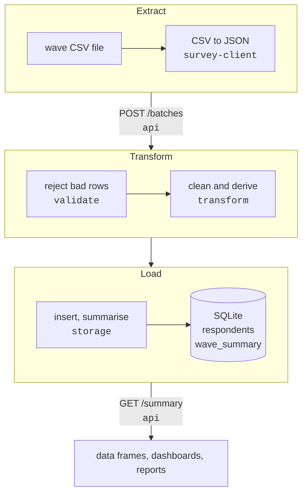
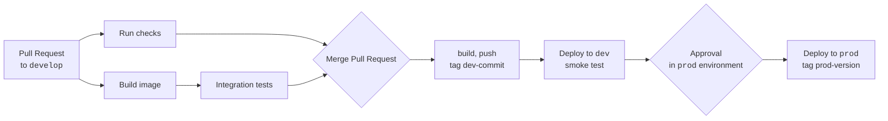

# etl-example

Tracking-survey ETL API example: validate, clean, transform, load
and summarise survey waves.

A brand-tracking survey arrives in waves. Each wave is a CSV file of
respondents with their interview date, birth year and, for three
brands, whether they know the brand (awareness) and use it (usage).
This project takes such files through a small ETL service and answers
questions like "how many 25-34 year olds knew brand 2 in the last two
waves?".

What it shows:

- a Python 3.14 package with validation, cleaning, transformation and
  loading kept as separate, tested stages;
- a FastAPI service with dev and prod settings, backed by SQLite
  through SQLAlchemy;
- a separate client standing for the program that collects the data;
- a slim, multi-stage Docker image run as a non-root user;
- CI on every pull request (checks, image build, integration tests in
  Docker) and CD with automatic dev and approved prod deployments.

## How it works



1. **Extract.** `survey-client to-json` turns a wave CSV file into
   JSON: whole numbers become numbers, empty cells become `null`,
   everything else stays text for the service to judge. The JSON is
   sent as the body of `POST /batches` to the API (`api`).
2. **Transform.**
   - **Reject bad rows** (`validate`). Each row is checked in turn; the
     first failing check rejects it with a reason, and the rest of the
     batch goes on.
     - `invalid_value`: a missing or extra column, a wrong type, a date
       not in `DD/MM/YYYY`, an answer other than 0, 1 or empty.
     - `underage`: younger than 18 in the interview year.
     - `no_answers`: every awareness and usage answer is empty.
     - `duplicated_id`: the respondent ID repeats in the batch or is
       already stored.
   - **Clean and derive** (`transform`).
     - Usage without awareness is corrected to 0 and reported.
     - Age in the interview year and its category are added: 18-24,
       25-34, 35-44, 45-54, 55+.
     - The interview date is stored as `YYYYMMDD`.
     - New rows are tagged `data_status = new`.
3. **Load** (`storage`). In one transaction, the new rows are inserted
   into `respondents` table, the summaries in `wave_summary` table of
   every wave that received rows are recalculated in SQL and the rows are
   switched to `current`. A late interview of an earlier wave therefore
   updates that wave's summary too. `POST /batches` then answers with
   what happened to every row.
4. **Read.** `GET /summary` (`api`) reads the stored summaries, ready
   for data frames, dashboards and reports.

## The sample scenario

`data/` holds three waves of 12 respondents.

| File | Content | Result |
|---|---|---|
| `wave1.csv` | wave 1, clean | 12 loaded |
| `wave2.csv` | wave 2, clean | 12 loaded |
| `wave3.csv` | wave 3 with problem rows and one late wave 2 interview | 9 loaded, 3 rejected, 1 corrected; waves 2 and 3 refreshed |

Rows of interest in `wave3.csv`:

| Respondent | What happens |
|---|---|
| 3003 | rejected: born 2010, 16 in the interview year |
| 1005 | rejected: ID already loaded with wave 1 |
| 3006 | rejected: `brand1_awareness` is 2 |
| 3007 | loaded, `brand3_usage` corrected to 0 (no awareness) |
| 2013 | loaded into wave 2, which now has 13 respondents |

## Quick start

Requirements: [uv](https://docs.astral.sh/uv/) (it installs Python
3.14 from `.python-version`), GNU Make, and Docker for the container
steps.

```bash
make install     # create .venv from uv.lock
make check       # lint, type-check and unit-test
make help        # list all targets
```

There are three ways to run the scenario.

1. **In one process, no server:** open
   `notebooks/local_scenario.ipynb` with the `.venv` kernel. FastAPI's
   test client calls the API directly and the database is a temporary
   file.
2. **Against a local server:**

   ```bash
   make run-dev                          # http://localhost:8000/docs
   # in a second terminal
   uv run survey-client to-json data/wave1.csv -o var/wave1.json
   uv run survey-client send var/wave1.json
   curl "http://localhost:8000/summary?wave_last=1"
   ```

3. **Against the Docker image:**

   ```bash
   make docker-build
   docker volume rm --force etl-example-dev   # start from no data
   make docker-run ENV=dev
   ```

   Then run `notebooks/docker_scenario.ipynb` and stop the container
   with `make docker-stop ENV=dev`. The data stays in the volume
   `etl-example-dev` until the volume is removed.

## API

| Method and path | Purpose | Answers |
|---|---|---|
| `GET /health` | liveness and environment | 200 |
| `POST /batches` | load a batch of respondents | 200 with the batch report; 422 for a malformed body; 409 if another upload stored the same respondent at the same moment |
| `GET /summary` | read stored summaries | 200; 404 if nothing matches; 422 for contradicting parameters |
| `GET /docs` | Swagger UI (dev only) | 200 in dev, 404 in prod |

`POST /batches` takes `{"respondents": [{...}, ...]}` with the CSV
columns as keys and answers with `rows_received`, `rows_loaded`,
`invalid_rows` (row number, ID, values as received, reason, details),
`corrected_values` and `refreshed_waves`.

`GET /summary` returns, per wave and age category, the respondent count
and the number aware of and using each brand. All parameters are
optional; nothing selects everything.

| Parameter | Selects |
|---|---|
| `wave` | one wave |
| `wave_last` | the latest *n* stored waves |
| `wave_from`, `wave_to` | a range of waves (either end may be left open) |
| `agecat` | one age category, by position: 1 = 18-24 … 5 = 55+ |
| `agecat_from`, `agecat_to` | a range of age categories (either end may be left open) |

Use at most one way of selecting waves and one of selecting age
categories; unknown parameters are rejected. For example,
`/summary?wave_from=2&agecat_from=2&agecat_to=3`.

## Configuration and environments

| Variable | Meaning | Default |
|---|---|---|
| `APP_ENV` | `dev` or `prod`; required, no fallback | none |
| `DATABASE_URL` | SQLAlchemy database URL | per environment, below |

| Environment | Database | Log level | API docs |
|---|---|---|---|
| `dev` | `sqlite:///var/dev.db` | `DEBUG` | on |
| `prod` | `sqlite:///var/prod.db` | `INFO` | off |

The database has two tables: `respondents` (one cleaned row per
respondent, keyed by ID) and `wave_summary` (totals per wave and age
category). The `# SQL:` comments in `src/survey_etl/storage/` show the
plain SQL behind each SQLAlchemy statement.

## Docker image

The `Dockerfile` has four stages:

1. `uv`: provides only the uv binary.
2. `dependencies`: installs the locked runtime dependencies into
   `/opt/venv`; rebuilt only when `pyproject.toml` or `uv.lock` change.
3. `project`: adds `survey_etl` and `survey_client` to that venv.
4. `runtime`: the venv on a clean `python:3.14.10-slim-trixie`, run as
   user 10001, with the database in the volume `/app/var` and a health
   check on `/health`. No uv, sources or dev tools are shipped.

Base images are pinned by tag and digest. `make docker-run ENV=dev|prod`
starts a container on port 8000 (dev) or 8001 (prod), bound to
127.0.0.1, with a named volume per environment.

## Tests

- `make check` runs ruff, hadolint, shellcheck, `mypy --strict` and
  the unit tests, with coverage of at least 95%.
- `make test-integration` starts containers of the image (`make
  docker-build` first) on free ports with their own volumes, runs the
  scenario and the prod checks over HTTP, and removes everything
  afterwards.
- `make smoke-test ENV=dev|prod` starts the image once and checks
  `/health` and `/docs`, as CD does.

## CI/CD



- **CI** (`.github/workflows/ci.yml`) runs on every pull request into
  `develop`, which accepts changes only through pull requests. `make
  check` and the image build run side by side; the integration tests
  then run against the image file the build job produced.
- **CD** (`.github/workflows/cd.yml`) runs after each merge. It builds
  the image once and pushes it to the GitHub Container Registry as
  `ghcr.io/cieslarjacek/etl-example:dev-<commit>`, smoke-tests it as
  dev, and after approval smoke-tests it as prod and adds the tag
  `prod-<version>` to the same image without rebuilding. A prod tag is
  never moved: a new release needs a new version in `pyproject.toml`.
- There are no servers yet. Each deploy job smoke-tests the image on
  the runner where a real deployment command would go.
- Actions are pinned to commit SHAs; the jobs get only the permissions
  they use.

## Project layout

```text
src/survey_etl/          the service
    layout.py            columns, brands, age categories of the survey
    settings.py          environments and environment variables
    validate/            row model and checks, invalid-row reports
    transform/           corrections and derived columns
    storage/             tables, SQL queries, the SurveyDatabase
    pipeline/            one batch through validate, transform, storage
    api/                 FastAPI app, routes and ASGI entry point
src/survey_client/       CSV to batch JSON, and upload over HTTP
tests/unit/              unit tests, mirroring the packages
tests/integration/       tests of the Docker image
data/                    sample waves
notebooks/               local_scenario and docker_scenario
scripts/                 run-container.sh, smoke-test.sh
.github/workflows/       ci.yml, cd.yml
```

`survey_client` never imports `survey_etl` (a ruff rule enforces it):
it stands for an outside program that knows only the HTTP API.
